Ran extract exact TATASTEEL data from both vec and our research
Ran check mermaid syntax

To compare what **`@[vec]`** has versus what **our research** captures on an **individual stock level**, let's inspect the exact data record for a benchmark security present in both systems: **`NSE:TATASTEEL` (Tata Steel Limited)**.

---

### Single-Security Architecture Diagram: `NSE:TATASTEEL`

```mermaid
flowchart TB
    subgraph COMPARISON["SINGLE SECURITY DEEP COMPARISON: NSE:TATASTEEL"]

        subgraph VEC_SIDE["VEC / ATLAS V3: Quantitative Factor & Risk Engine"]
            direction TB
            V_META["1. Portfolio & Institutional Metadata<br/>• Canonical ID: NSE:TATASTEEL:EQ<br/>• ISIN: INE081A01020 | Series: EQ<br/>• Tier: Tier 1 Core Institutional<br/>• Market Cap: ₹2,11,158 Cr<br/>• Sector: Steel & Iron Products<br/>• Business Family: STEEL_IRON_ORE_METALLURGY"]
            
            V_VEC["2. 175-Dimensional Normalized Factor Vector<br/>• Dense Representation: 175-dim float array<br/>• Sparse Feature Vector (vector_sparse):<br/>  - activities: STEEL_IRON_ORE_METALLURGY: 0.7071<br/>  - models: B2B_MANUFACTURING_PROCESSING: 0.5477<br/>  - markets: AUTOMOTIVE_OEMS: 0.3596<br/>  - drivers: METAL_PRICES: 0.2067<br/>  - markets: CONSTRUCTION_CUSTOMERS: 0.1438<br/>  - drivers: VEHICLE_DEMAND: 0.0827<br/>  - drivers: CONSTRUCTION_CYCLE: 0.0207"]
            
            V_MANIFOLD["3. 3D Manifold Cluster Coordinates<br/>• position: [6.9476, 1.1874, -1.2816]<br/>• Visual spatial coordinates for Atlas 3D cluster UI"]
            
            V_EXPOSURE["4. Macro Benchmark Factor Scenarios<br/>• Factor: STEEL_PRICE (+10% HRC benchmark)<br/>• Scenario ID: STEEL_INR_UP10_12M_PBT_V1<br/>• Polarity: +1 (Directional Core Exposure)"]
            
            V_PEERS["5. Statistical Peer Graph (Cosine Proximity)<br/>• Usha Martin: score 0.8623<br/>• JSW Steel: score 0.8623<br/>• Shyam Metalics: score 0.8623<br/>(Mathematical proximity without supply-chain links)"]

            V_META --> V_VEC
            V_VEC --> V_MANIFOLD
            V_VEC --> V_EXPOSURE
            V_VEC --> V_PEERS
        end

        subgraph OUR_SIDE["OUR RESEARCH: Physical Causal & Moat Ontology"]
            direction TB
            O_PHYSICAL["1. Physical Intermediate Supply Chain<br/>• makes: HRC, Cold-Rolled Sheets, Auto-Galvanized, Tiscon Rebars<br/>• depends_on: Captive Iron Ore (Noamundi/Joda), Imported Coking Coal,<br/>  Kalinganagar/Jamshedpur Mega Blast Furnaces, Dhamra Deepwater Port"]
            
            O_MOAT["2. 4-Pillar Structural Moats<br/>• Positional: Pithead blast furnaces atop Jharkhand/Odisha hematite belt<br/>• Product: Auto CRCA skin-panel qualification (Tata Motors, Maruti, Hyundai)<br/>• Technological: 5,870 m³ mega blast furnaces with PCI & 100% pelletization<br/>• Governance: Tata Sons stewardship & ring-fenced UK EAF subsidies"]
            
            O_ECONOMICS["3. Conversion Physics & Unit Economics<br/>• EBITDA Band: ₹13,500 - ₹17,000 / MT (Standalone India BF-BOF)<br/>• Feedstock Yield: 1.6t Fe Ore + 0.8t Coking Coal -> 1t Liquid Steel<br/>• Pass-Through: Monthly list prices tracking import parity + brand premium<br/>• CFO-to-EBITDA: 78% - 86% cash conversion discipline"]
            
            O_POLARITY["4. Sign-Explicit Causal Micro Polarities<br/>• Domestic/LME Metal Prices: +1<br/>• Coking Coal & Power Costs: -1<br/>• China Steel Dumping: -1<br/>• Domestic Infra & EV Capex: +1<br/>• Iron Ore Inflation: 0 (Insulated via 100% captive mines)"]
            
            O_EVENTS["5. 2026 Factual Catalysts & Event Tags<br/>• Kalinganagar Phase-2 Brownfield (8 MTPA)<br/>• DGTR 12% Safeguard Duty & $675/t MIP Floor Protection<br/>• Supreme Court MADA Mineral Cess Payout (April 2026)<br/>• UK Port Talbot Blast Furnace to EAF Decarbonization<br/>• EU CBAM Export Carbon Tariff Definitive Regime 2026"]

            O_PHYSICAL --> O_MOAT
            O_MOAT --> O_ECONOMICS
            O_ECONOMICS --> O_POLARITY
            O_POLARITY --> O_EVENTS
        end

    end
```

---

### Detailed Single-Security Data Field Comparison

| Data Dimension | What `@[vec]` Stores for `NSE:TATASTEEL` | What Our Research Stores for `NSE:TATASTEEL` | Key Architectural Difference |
| :--- | :--- | :--- | :--- |
| **1. Identity & Classification** | `canonicalId`: `"NSE:TATASTEEL:EQ"` `isin`: `"INE081A01020"` `tier`: `"Tier 1"` `sector`: `"Steel & Iron Products"` | `id`: `"NSE:TATASTEEL"` `entity_type`: `"LISTED_INDIA"` `sub_vertical`: `"INTEGRATED_PRIMARY_STEEL"` `principal`: `TATA_GROUP_CONGLOMERATE` | `vec` stores trading identifiers and market-cap tiers; we store industrial parentage and sub-vertical role. |
| **2. Operations & Products** | Broad classification tag: `activities:STEEL_IRON_ORE_METALLURGY: 0.7071` `models:B2B_MANUFACTURING_PROCESSING: 0.5477` | Granular physical outputs (`makes`): • Hot-Rolled & Cold-Rolled Coils • Automotive Galvanized Skin Panels • Tiscon Rebars & Ferro Chrome | `vec` assigns abstract industry weights; we list the exact physical products sold. |
| **3. Upstream Feedstock & Dependencies** | Abstract driver exposure: `drivers:METAL_PRICES: 0.2067` `drivers:CONSTRUCTION_CYCLE: 0.0207` | Grounded physical inputs (`depends_on`): • Captive Iron Ore (Noamundi & Joda leases) • Seaborne Australian Hard Coking Coal • Jamshedpur & Kalinganagar Blast Furnaces • Dhamra Deepwater Port & sidings | `vec` treats raw materials as an abstract macro factor; we track the physical mines, ports, and leases. |
| **4. Unit Economics & Pricing Mechanics** | Not captured (treated as an unobservable beta) | `conversion_physics` & `pass_through`: • **Yield**: `1.6t Fe Ore + 0.8t Coal -> 1t Steel` • **EBITDA Range**: `₹13,500 - ₹17,000 / MT` • **Pass-Through**: Monthly list price updates on import parity; quarterly auto OEM contracts | `vec` has no unit-economic physics; we define the exact conversion formulas and margin pass-through lags. |
| **5. Moats & Competitive Insulation** | Generalized qualitative narrative string (`identityNote`) | Rigorous 4-Pillar Moat Framework (`moat_vectors`): • **Positional**: Pithead blast furnaces atop iron belt • **Product**: Auto outer-body panel approvals • **Technological**: 5,870 m³ blast furnaces + PCI • **Governance**: Ring-fenced UK EAF debt | `vec` stores unstructured text; we deconstruct moats into 4 verifiable structural pillars. |
| **6. Sensitivity & Causal Shocks** | 1 macro factor scenario: `STEEL_PRICE (+10% HRC)` $\rightarrow$ `polarity: 1` | Bespoke Sign-Explicit Polarities (`+1`, `-1`, `0`): • Steel Prices: `+1` • Coking Coal Spikes: `-1` • **Iron Ore Shocks: `0` (Captive Insulation)** • China Dumping: `-1` • Rate Cuts: `+1` | `vec` applies uniform steel price sensitivity; we differentiate that Tata Steel is **completely insulated (polarity 0)** from iron ore spikes because of its captive mines. |
| **7. Relational Graph Edges** | **Statistical Cosine Peers (`peers`)**: • Usha Martin (`0.8623`) • JSW Steel (`0.8623`) • Shyam Metalics (`0.8623`) | **Directed Causal Links**: • *Supplies*: `NSE:APLAPOLLO`, `NSE:TATAMOTORS` • *Competes with*: `NSE:JSWSTEEL`, `NSE:SAIL` • *Feeds from*: Captive mines & Australian coal | `vec` edges measure statistical similarity; our edges trace physical goods moving through the economy. |
| **8. Forward Catalysts** | Static provisional model prior | **Late-2026 Event Tags (`event_tags`)**: • Kalinganagar Phase-2 (8 MTPA brownfield) • DGTR 12% Safeguard Duty & $675/t MIP Floor • Supreme Court MADA Mineral Cess payout • EU CBAM carbon tariff regime in 2026 | `vec` has no forward event tracking; our graph links each company to active regulatory and capex catalysts. |

---

### In Summary: How the Two Data Models Differ

- **`@[vec]` answers:** *"How does the market mathematically price and correlate this stock across 175 macroeconomic and sector factors, and where does it sit in a 3D portfolio cluster manifold?"*
- **Our research answers:** *"What physical blast furnaces, captive ore leases, chemical conversion ratios, contractual pricing formulas, and regulatory moats actually generate that cash flow in the real economy?"*