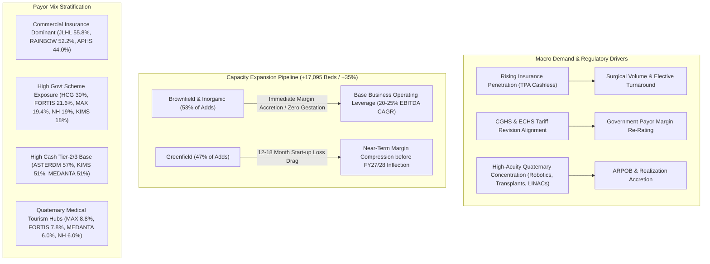

# Indian Hospital & Tertiary Healthcare Sector Ontology
**Document Provenance:** Prabhudas Lilladher Institutional Sector Report (*Hospitals-19-12-25-PL.pdf*, Dec 19, 2025)  
**Machine-Ready Repository:** [`hospitals_sector.jsonl`](file:///Users/prasad/pdfs/hospital/hospitals_sector.jsonl)  
**Canonical Scope:** 10 Coverage Hospital Chains (48,839 FY25 Beds $\rightarrow$ 65,934 FY28 Beds)

---

## 1. Executive Sector Blueprint & Operating Physics

The Indian private tertiary and quaternary healthcare ecosystem is undergoing a structural transformation characterized by **corporatization, surgical case-mix elevation, commercial insurance deepening, and large-scale brownfield/greenfield bed expansions**.

### Core Operating KPI Rulers & Frontier Benchmarks
* **Bed Capacity:** Top 10 chains operated **48,839 beds** in FY25, adding **17,095 beds** by FY28 (+35% / 10.5% CAGR).
* **Brownfield (53%) vs. Greenfield (47%):** Chains prioritizing brownfield additions (`NSE:FORTIS` 91%, `NSE:HCG` 82%, `NSE:MAXHEALTH` 69%) bypass start-up EBITDA losses, whereas greenfield-heavy developers (`NSE:JLHL` 100%, `NSE:MEDANTA` 86%, `NSE:APOLLOHOSP` 85%, `NSE:NH` 81%, `NSE:KIMS` 59%) face a 12–18 month initial margin drag.
* **ARPOB (₹ '000/day):**
  * `P100 Benchmark:` **₹77.6k/day** (`NSE:MAXHEALTH`)
  * `P50 Benchmark:` **₹60k–₹66k/day** (`NSE:FORTIS`, `NSE:MEDANTA`, `NSE:JLHL`, `NSE:APOLLOHOSP`)
  * `Value / Regional Tier:` **₹42k–₹50k/day** (`NSE:KIMS`, `NSE:HCG`, `NSE:NH`, `NSE:ASTERDM`)
* **EBITDA per Occupied Bed (₹ Mn/yr):**
  * `P100 Benchmark:` **₹7.1 Mn** (`NSE:MAXHEALTH`)
  * `P50 Benchmark:` **₹5.4–₹5.7 Mn** (`NSE:JLHL`, `NSE:MEDANTA`, `NSE:RAINBOW`, `NSE:APOLLOHOSP`, `NSE:FORTIS`)
  * `Turnaround / High Volume Tier:` **₹2.4–₹3.3 Mn** (`NSE:HCG`, `NSE:KIMS`)
* **Average Length of Stay (ALOS):** Ranges from **2.0 days** at `NSE:HCG` (day-care chemotherapy/radiotherapy) to **4.5 days** at `NSE:NH` (complex quaternary cardiac surgery and multi-organ transplants).

---

## 2. Cross-Chain Comparative KPI Matrix

| Canonical Ticker | Hospital Platform | Sub-Vertical | FY25 Beds | Planned Adds (FY28) | Brownfield % | Greenfield % | Occupancy (1HFY26) | ARPOB (₹k/day) | ARPP (₹k) | ALOS (days) | EBITDA / Bed (₹ Mn) | Payor Mix (Cash/Ins/Govt/Intl) | FY25 EBITDA Margin |
| :--- | :--- | :--- | :---: | :---: | :---: | :---: | :---: | :---: | :---: | :---: | :---: | :---: | :---: |
| **`NSE:APOLLOHOSP`** | Apollo Hospitals Enterprise | `MULTI_SPECIALTY_TERTIARY_CHAIN` | 9,747 | 2,671 | 15% | 85% | 67.0% | 60.6 | 163 | 3.3 | 5.6 | 41% / 44% / 10% / 5% | 23.1% |
| **`NSE:ASTERDM`** | Aster DM + QCIL (CARE) | `REGIONAL_CLUSTER_HOSPITAL_NETWORK` | 10,301 | 3,120 | 57% | 43% | 61.0% | 50.4 | 111 | 3.2 | 4.1 | 57% / 30% / 10% / 4% | 20.3% |
| **`NSE:FORTIS`** | Fortis Healthcare | `MULTI_SPECIALTY_TERTIARY_CHAIN` | 4,096 | 1,676 | 91% | 9% | 70.0% | 68.2 | 278 | 4.2 | 5.4 | 34% / 36% / 22% / 8% | 20.1% |
| **`NSE:MEDANTA`** | Global Health (Medanta) | `MULTI_SPECIALTY_TERTIARY_CHAIN` | 3,042 | 3,340* | 14% | 86% | 63.4% | 66.1 | 199 | 3.2 | 5.7 | 51% / 25% / 18% / 6% | 23.8% |
| **`NSE:HCG`** | HealthCare Global | `SPECIALTY_ONCOLOGY_AND_PEDIATRIC_CHAIN` | 2,500 | 571 | 82% | 18% | 68.7% | 44.6 | 81 | 2.0 | 2.4 | 42% / 25% / 30% / 3% | 13.2% |
| **`NSE:JLHL`** | Jupiter Life Line Hospitals | `REGIONAL_CLUSTER_HOSPITAL_NETWORK` | 1,194 | 500 | 0% | 100% | 62.2% | 66.1 | 236 | 3.9 | 5.7 | 40% / 56% / 1% / 3% | 23.5% |
| **`NSE:KIMS`** | Krishna Inst. of Medical Sciences | `REGIONAL_CLUSTER_HOSPITAL_NETWORK` | 5,179 | 2,496 | 41% | 59% | 61.7% | 42.5 | 143 | 3.7 | 3.3 | 51% / 29% / 18% / 2% | 25.0% |
| **`NSE:MAXHEALTH`** | Max Healthcare Institute | `MULTI_SPECIALTY_TERTIARY_CHAIN` | 5,100 | 3,032 | 69% | 31% | 76.0% | 77.6 | 296 | 4.0 | 7.1 | 34% / 38% / 19% / 9% | 25.7% |
| **`NSE:NH`** | Narayana Hrudayalaya | `MULTI_SPECIALTY_TERTIARY_CHAIN` | 5,745 | 1,185 | 0% | 100% | 60.0% | 48.1 | 142 | 4.5 | 4.3 | 45% / 30% / 19% / 6% | 19.4% |
| **`NSE:RAINBOW`** | Rainbow Children's Medicare | `SPECIALTY_ONCOLOGY_AND_PEDIATRIC_CHAIN` | 1,935 | 630 | 63% | 37% | 46.3% | 59.9 | 154 | 2.9 | 5.7 | 45% / 52% / 0% / 3% | 26.6% |

*\*Note: Medanta planned additions reflect its full 5-year pipeline of 3,340 beds (1,440 beds till FY28).*

---

## 3. Detailed Entity Overviews

### 1. `NSE:APOLLOHOSP` — Apollo Hospitals Enterprise Limited
* **Operating Model:** India's integrated healthcare bellwether combining 9,747 hospital beds, 6,000+ Apollo Pharmacy retail stores, Apollo 24/7 digital health omnichannel, and non-captive Apollo Diagnostics.
* **Expansion Mechanics:** 4,486-bed pipeline by FY30 (2,671 beds by FY28) across Pune, Hyderabad, Kolkata, Delhi-NCR, and Bengaluru. Predominantly greenfield (85%) with Rs 83bn total capex (Rs 58bn unspent). Guided initial drag of Rs 1.5bn from 6 new units is comfortably buffered by margin expansion in the mature base business.
* **Financial Physics:** Pre-IND AS EBITDA margin of 23.1% in FY25 expanding to 23.5% by FY28; ARPOB Rs 60.6k/day; EBITDA/occupied bed Rs 5.6 Mn.

### 2. `NSE:ASTERDM` — Aster DM Healthcare Limited
* **Operating Model:** Post-GCC divestment pure-play Indian platform merged with Quality Care India Limited (QCIL / CARE Hospitals), creating a 10,301-bed powerhouse across Kerala, Karnataka, Andhra Pradesh, Telangana, Maharashtra, MP, and Odisha.
* **Expansion Mechanics:** Adding 4,202 beds by FY29 (3,120 beds by FY28; 57% brownfield/inorganic). Brownfield focus centered in QCIL locations (Indore, Raipur, Bhubaneswar) alongside greenfields in Thiruvananthapuram and Bengaluru.
* **Financial Physics:** Pre-IND AS EBITDA margin of 20.3% (Aster standalone) / 18.4% (combined) climbing to 21.1% by FY28 (+263 bps). Sector's highest cash payor mix at 57% protects direct billing realization.

### 3. `NSE:FORTIS` — Fortis Healthcare Limited
* **Operating Model:** Metro-focused quaternary hospital chain backed by IHH Healthcare Berhad, operating iconic campuses FMRI Gurugram, Fortis Escorts Heart Institute, Mulund Mumbai, and Agilus Diagnostics.
* **Expansion Mechanics:** 1,676 bed additions till FY28 (+41%), overwhelmingly brownfield-driven (91%) across NCR, Punjab, and Bengaluru, eliminating start-up margin drag. Potential +1,200 beds via Gleneagles Hospital merger.
* **Financial Physics:** Sector-high projected EBITDA margin expansion of +471 bps from 20.1% to 24.9% by FY28. ARPP at Rs 278k; ARPOB Rs 68.2k; CGHS tariff revision beneficiary via 21.6% government scheme mix.

### 4. `NSE:MEDANTA` — Global Health Limited
* **Operating Model:** Large-format monolithic quaternary hospital institutes founded by Dr. Naresh Trehan, with heavy clinical tilt toward complex cardiology, neurosciences, oncology, and transplants (65% tertiary/quaternary case mix).
* **Expansion Mechanics:** 3,340 beds over 5 years (86% greenfield; 1,440 beds till FY28) backed by Rs 41bn capex and Rs 8bn net cash. Key pipelines: South Delhi (400 beds DLF JV), Pitampura O&M (750 beds), Oshiwara Mumbai (750 beds), and Guwahati (400 beds). Newly opened Noida unit (226 beds) breakeven expected in FY27.
* **Financial Physics:** ARPOB Rs 66.1k/day; EBITDA/occupied bed Rs 5.7 Mn; pre-IND AS EBITDA margin of 23.8% recovering to 23.6% by FY28 after Noida gestation.

### 5. `NSE:HCG` — HealthCare Global Enterprises Limited
* **Operating Model:** India's largest dedicated cancer care hospital network operating 2,500 beds with comprehensive surgical, medical, and LINAC radiation oncology capabilities.
* **Expansion Mechanics:** 1,000+ beds and 10+ LINACs over 4-5 years (571 beds by FY28), 82% brownfield across Ahmedabad, Vizag, Baroda, and Cuttack. Capex Rs 6bn funded via cash and debt.
* **Financial Physics:** Shortest ALOS in coverage (2.0 days) driven by high daycare chemotherapy turnaround. Highest government scheme exposure (30.0%) delivers outsized upside from CGHS tariff revisions, driving a 440 bps margin expansion to 17.6% by FY28 with 26% EBITDA CAGR.

### 6. `NSE:JLHL` — Jupiter Life Line Hospitals Limited
* **Operating Model:** Regional multi-specialty operator dominating underpenetrated suburban micro-markets (Thane, Baner Pune, Indore) under a clinician-led "Patient First" all-under-one-roof care model.
* **Expansion Mechanics:** Doubling capacity from 1,194 to 2,500 beds by FY30 by commercializing 1 greenfield per year: Dombivli (500 beds FY27), Pune Bibwewadi (500 beds FY29), Mira Road (300 beds FY30).
* **Financial Physics:** Highest private commercial insurance penetration in India (55.8%) paired with negligible government scheme exposure (1.3%), yielding top-tier ARPOB of Rs 66.1k/day, EBITDA/bed of Rs 5.7 Mn, and steady 23.5% margins.

### 7. `NSE:KIMS` — Krishna Institute of Medical Sciences Limited
* **Operating Model:** High-volume, affordable tertiary care powerhouse dominant in Andhra Pradesh and Telangana, expanding into Maharashtra and Karnataka clusters.
* **Expansion Mechanics:** Adding 2,500+ beds over FY25-27E (41% brownfield, 59% greenfield; Rs 10.6bn capex for remaining 1,561 beds), plus 1,100 beds under asset-light O&M contracts with future buyback rights.
* **Financial Physics:** Fastest EBITDA CAGR in coverage at 32% over FY26-28E. Greenfield additions caused a temporary margin trough in FY26 (21.1%), but ramp-up rebounds margins to 24.6% by FY28. ARPOB at Rs 42.5k/day.

### 8. `NSE:MAXHEALTH` — Max Healthcare Institute Limited
* **Operating Model:** Unrivaled metropolitan quaternary market leader in Delhi-NCR, operating flagship Saket Complex, Patparganj, Shalimar Bagh, Dwarka, and Nanavati Mumbai, alongside non-captive Max Lab.
* **Expansion Mechanics:** Doubling capacity from 5,100 to ~11,000 beds by FY30 (+3,032 beds by FY28; 69% brownfield). Over 50% of pipeline concentrated in high-yielding NCR catchments, funded via Rs 65bn internal cash accruals. Seamlessly assimilating Sahara Lucknow, Alexis Nagpur, and Jaypee Noida.
* **Financial Physics:** Sector P100 gold standard across ARPOB (Rs 77.6k/day) and EBITDA/occupied bed (Rs 7.1 Mn) with 76% occupancy. Highest medical tourism mix (8.8%) and 19.4% government scheme exposure that gains from CGHS rate hikes.

### 9. `NSE:NH` — Narayana Hrudayalaya Limited
* **Operating Model:** Low-cost, assembly-line quaternary cardiac and multi-specialty system founded by Dr. Devi Shetty, complemented by an offshore cash-cow in Health City Cayman Islands.
* **Expansion Mechanics:** Adding 1,185 beds by FY28 (1,945 beds through FY29) across Bengaluru, Kolkata, and Raipur. Near-term strategy focuses on debottlenecking and refurbishment (Rs 30bn capex), lifting ARPOB to Rs 48.1k/day before greenfield commercialization in FY28/29.
* **Financial Physics:** Cayman Islands operates at ~40% EBITDA margins, generating dollar cash flows that cross-subsidize domestic growth. 19.0% government scheme exposure offers direct CGHS tariff tailwinds.

### 10. `NSE:RAINBOW` — Rainbow Children's Medicare Limited
* **Operating Model:** India's premier pure-play pediatric, neonatal (Level-IV NICU/PICU), and perinatal quaternary network (1,935 beds) operating across Hyderabad, Bengaluru, Chennai, and Delhi-NCR.
* **Expansion Mechanics:** 630-bed pipeline through FY28 (+33%), 63% brownfield/inorganic (Warangal, Guwahati, Rajahmundry) with limited additions in FY27/28 to ramp up utilization before launching the 400-bed Gurugram greenfield in FY28/29.
* **Financial Physics:** Pristine balance sheet with zero debt and Rs 5.5bn net cash. Exactly 0.0% government scheme exposure protects 100% commercial realizations. High insurance mix (52.2%) powers ARPOB of Rs 59.9k/day and 26.6% pre-IND AS EBITDA margins.

---

## 4. Polarity & Sensitivity Dynamics

| Entity ID | Surgical Case Mix & ARPOB Up | CGHS & Govt Tariff Hikes | Health Insurance Penetration Up | Greenfield Bed Startup Drag | Doctor Attrition & Inflation | Medical Tourism Inflows Up |
| :--- | :---: | :---: | :---: | :---: | :---: | :---: |
| **`NSE:APOLLOHOSP`** | `+1` | `+1` (10.0% mix) | `+1` | `-1` (85% greenfield) | `-1` | `+1` (5.0% mix) |
| **`NSE:ASTERDM`** | `+1` | `+1` (9.6% mix) | `+1` | `-1` (43% greenfield) | `-1` | `+1` (4.0% mix) |
| **`NSE:FORTIS`** | `+1` | `+1` (21.6% mix) | `+1` | `+1` (91% brownfield) | `-1` | `+1` (7.8% mix) |
| **`NSE:MEDANTA`** | `+1` | `+1` (18.0% mix) | `+1` | `-1` (86% greenfield) | `-1` | `+1` (6.0% mix) |
| **`NSE:HCG`** | `+1` | `+1` (30.0% mix) | `+1` | `+1` (82% brownfield) | `-1` | `0` (3.0% mix) |
| **`NSE:JLHL`** | `+1` | `0` (1.3% mix) | `+1` | `-1` (100% greenfield) | `-1` | `0` (3.0% mix) |
| **`NSE:KIMS`** | `+1` | `+1` (18.0% mix) | `+1` | `-1` (59% greenfield) | `-1` | `0` (2.0% mix) |
| **`NSE:MAXHEALTH`** | `+1` | `+1` (19.4% mix) | `+1` | `+1` (69% brownfield) | `-1` | `+1` (8.8% mix) |
| **`NSE:NH`** | `+1` | `+1` (19.0% mix) | `+1` | `-1` (81% greenfield) | `-1` | `+1` (6.0% mix) |
| **`NSE:RAINBOW`** | `+1` | `0` (0.0% mix) | `+1` | `-1` (37% greenfield) | `-1` | `0` (3.0% mix) |
