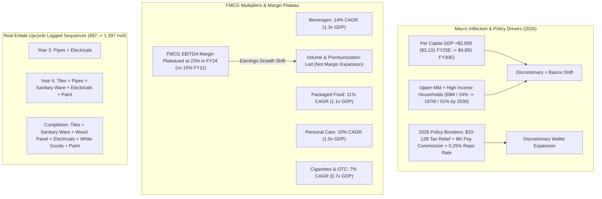

# Consumer Staples & Discretionary Macro Knowledge Graph & Conviction Delta
**Source Document:** Mirae Asset Great Consumer Fund Institutional Presentation (*May 2026*)  
**Machine-Ready Repository:** [`consumer_macro_delta.jsonl`](file:///Users/prasad/pdfs/reports/consumer_macro_delta.jsonl) (mirror at [`consumer_macro_delta.jsonl`](file:///Users/prasad/pdfs/consumer_macro_delta.jsonl))  
**Master Unified Graph:** [`master_unified_graph.jsonl`](file:///Users/prasad/pdfs/master_unified_graph.jsonl)  
**Scope:** 1 `SECTOR_BLUEPRINT` + 8 `DELTA_UPDATE` records (Top-10 holdings) + 2 `NEW_ENTITY` baselines (`NSE:ETERNAL` & `NSE:BHARTIARTL`)

---

## 1. Executive Sector Blueprint & Macro Operating Physics

India's consumption trajectory is crossing a structural inflection driven by **per-capita income crossing the \$2,000 threshold (\$3,131 in FY25E $\rightarrow$ \$4,891 in FY30E)**, upper-middle household expansion, real estate completion wave tailwinds, and aggressive monetary/fiscal stimulus in 2026.

### FMCG Sub-Category GDP Growth Multipliers (FY14–24 Sales CAGR)
* **Outperformers (>1.0x GDP Multiplier):**
  * `Beverages:` **14% Sales CAGR (1.3x GDP)** — #1 growth sub-segment (Varun Beverages, Tata Consumer).
  * `Packaged Food:` **11% Sales CAGR (1.1x GDP)** — Driven by convenience and nuclearization.
  * `Personal Care:` **10% Sales CAGR (1.0x GDP)** — Premium skin/hair and direct-to-consumer penetration.
* **Underperformers (<1.0x GDP Multiplier):**
  * `Cigarettes:` **7% Sales CAGR (0.7x GDP)** — Regulatory taxation drag and volume plateau.
  * `OTC FMCG:` **7% Sales CAGR (0.7x GDP)**.
  * `Hair Care:` **6% Sales CAGR (0.6x GDP)**.
  * `Oral Care:` **5% Sales CAGR (0.5x GDP)**.
  * `Home Care:` **5% Sales CAGR (0.5x GDP)**.
  * `Total FMCG Sector:` **9% Sales CAGR (0.9x GDP)**.
* **Margin Plateau Mechanics:** Top FMCG EBITDA margins expanded from **15% in FY11** $\rightarrow$ **19% in FY17** $\rightarrow$ **23% in FY24**. Having reached optimum pricing power, future earnings growth must be driven by **sales volume and premiumization mix** rather than further EBITDA margin expansion.

---

## 2. Real Estate Upcycle Lagged Building Materials Sequencer

Tier 1 & Tier 2 residential completions are projected to **double from 687 msf in FY23 to 1,397 msf in FY27E** (790 msf in FY24, 1,100 msf in FY25E), triggering sequential category demand waves:

| Construction Timeline | Primary Building Materials in Demand | Master Graph Proxies |
| :--- | :--- | :--- |
| **Year 3** | Pipes, Electricals | `NSE:ASTRAL`, `NSE:SUPREMEIND`, `NSE:POLYCAB`, `NSE:KEI` |
| **Year 4** | Tiles, Pipes, Sanitary Ware, Electricals, Paint | `NSE:KAJARIACER`, `NSE:CERA`, `NSE:ASIANPAINT`, `NSE:BERGEPAINT` |
| **Completion** | Tiles, Sanitary Ware, Wood Panel, Electricals, White Goods, Paint | `NSE:CENTURYPLY`, `NSE:VOLTAS`, `NSE:BLUESTARCO`, `NSE:HAVELLS`, `NSE:ASIANPAINT` |

---

## 3. Structural Premiumization & Organized Penetration Benchmarks

* **Income Pyramid Shift (2018 $\rightarrow$ 2030F):**
  * High-income households (`>$40k / ₹30L+`): Rising from **8M** (3%) to **29M** (7%).
  * Upper-middle households (`$8k–$40k / ₹6L–₹30L`): Rising from **61M** (21%) to **168M** (44%).
  * **Combined Upper-Mid + High Income:** Surging from **24% (1 in 4)** in 2018 to **51% (1 in 2)** by 2030.
  * Low-income households (`<$4k / ₹3L`): Shrinking by **~70M** (from 151M/63% in 2005 to 57M/15% in 2030).
* **Category Premiumization Trajectory:**
  * Liquid Detergent: ~10% share of laundry industry.
  * Body Wash: 5% share of personal wash.
  * Semi-Premium & Above Whisky: **35% share** in 2026 vs. 18% in CY13.
  * SUVs in Passenger Vehicles: **56.0% volume share in FY25E** vs. 18.3% in FY17 (hatchbacks collapsed from 50.0% to 23.5%).
  * Premium Motorcycles (>250cc): Resilient at **15.1% penetration** in FY25E.
  * Electric 2-Wheelers (E-2W): Penetration reaching **~5.8%**.
* **Organized Retail Penetration (FY24 $\rightarrow$ FY29E):**
  * Overall Retail: 20% $\rightarrow$ **30%** (18% CAGR to \$1,500B market).
  * Food Services (Restaurants): 40% $\rightarrow$ **55%** (\$70B $\rightarrow$ \$120B).
  * Jewellery: 38% $\rightarrow$ **43%** (\$80B $\rightarrow$ \$165B).
  * Apparel: 50% $\rightarrow$ **57%** (\$71B $\rightarrow$ \$116B).
  * Grocery: 8% $\rightarrow$ **12%** (\$568B $\rightarrow$ \$838B).
* **2026 Macro & Policy Drivers:**
  * **Budget Tax Relief:** \$10–\$12B annual disposable income boost, primarily benefiting ₹12L–₹50L income brackets (tax rates cut by 2.6% to 5.2%).
  * **8th Pay Commission:** Wage hike effective **January 2026** directly lifting disposable income for 10M+ mid-income households.
  * **Monetary Policy:** Repo rate eased to **5.25%**, 50 bps CRR reduction, and relaxed risk weights on NBFCs/MFIs. Headline CPI at **3.93%** (May 2026).

---

## 4. Institutional Portfolio Positioning & Active Conviction Tilts

| Sector / Industry | Portfolio Weight (%) | Benchmark Weight (%)* | Active Tilt (%) | Primary Stance |
| :--- | :---: | :---: | :---: | :--- |
| **Retail (Value Fashion & Apparel)** | 15.02% | 4.76% | **+10.27% OW** | Sector's largest active overweight; formalization play (`NSE:TRENT`) |
| **Consumer Durables** | 8.48% | 0.94% | **+7.54% OW** | Penetration play (ACs 8%, Washing Machines 15%, Refrigerators 40%) |
| **Home Improvement** | 3.64% | 0.00% | **+3.64% OW** | Proxy play on real estate completion wave |
| **Consumer Services** | 8.72% | 5.44% | **+3.27% OW** | New-age food delivery & quick commerce (`NSE:ETERNAL`) |
| **Retail Jewellery** | 8.30% | 5.30% | **+3.00% OW** | Unorganized-to-organized market share shift (`NSE:TITAN`) |
| **Tyres** | 1.60% | 0.00% | **+1.60% OW** | Auto replacement cycle |
| **Building Materials** | 0.42% | 0.00% | **+0.42% OW** | Real estate upcycle proxy |
| **Paints** | 3.92% | 3.55% | **+0.37% OW** | Year 4 / Completion decorative demand wave (`NSE:ASIANPAINT`) |
| **Auto OEM** | 19.06% | 24.96% | **-5.91% UW** | Underweight due to rich valuations and commodity headwinds |
| **Utilities / Power** | 0.00% | 5.02% | **-5.02% UW** | Non-core consumption proxy |
| **Fast Moving Consumer Goods (FMCG)** | 13.35% | 18.20% | **-4.85% UW** | Underweight due to 23% margin ceiling & 0.9x GDP growth |
| **Tobacco** | 4.65% | 9.01% | **-4.36% UW** | Sub-GDP growth (0.7x multiplier) |
| **Telecom** | 6.37% | 9.50% | **-3.14% UW** | Underweight index allocation while holding quality duopoly (`NSE:BHARTIARTL`) |
| **Hospitals** | 2.54% | 4.85% | **-2.31% UW** | Fair valuations post-COVID run |
| **Aviation** | 0.89% | 3.02% | **-2.12% UW** | Crude volatility and aircraft availability constraints |

*\*Benchmark: Nifty India Consumption Index (TRI).*

---

## 5. Top 10 Portfolio Holdings & Entity Deltas

| Canonical Ticker | Company Name | Fund Weight (%) | Sub-Sector Positioning | Active Stance | Master Graph Status |
| :--- | :--- | :---: | :--- | :--- | :--- |
| **`NSE:ETERNAL`** | Eternal Limited (erstwhile Zomato) | **6.89%** | Quick Commerce & Food Platforms | Top Holding (#1) | `NEW_ENTITY` |
| **`NSE:TITAN`** | Titan Company Limited | **6.59%** | Retail Jewellery | +3.00% OW | `DELTA_UPDATE` |
| **`NSE:MARUTI`** | Maruti Suzuki India Limited | **6.59%** | Auto OEM | -5.91% UW | `DELTA_UPDATE` |
| **`NSE:M&M`** | Mahindra & Mahindra Limited | **6.51%** | Auto OEM - SUVs & Tractors | Stock Specific OW | `DELTA_UPDATE` |
| **`NSE:BHARTIARTL`** | Bharti Airtel Limited | **6.29%** | Telecom & Digital Infrastructure | Top 5 Holding | `NEW_ENTITY` |
| **`NSE:TRENT`** | Trent Limited | **4.80%** | Value Fashion & Retail | +10.27% OW | `DELTA_UPDATE` |
| **`NSE:ITC`** | ITC Limited | **4.40%** | Cigarettes & Packaged Foods | -4.36% UW | `DELTA_UPDATE` |
| **`NSE:ASIANPAINT`** | Asian Paints Limited | **4.39%** | Paints & Home Improvement | +3.64% OW | `DELTA_UPDATE` |
| **`NSE:EICHERMOT`** | Eicher Motors Limited | **4.10%** | Auto OEM - Premium 2W | Stock Specific OW | `DELTA_UPDATE` |
| **`NSE:VBL`** | Varun Beverages Limited | **3.87%** | FMCG - Beverages (1.3x GDP) | Stock Specific OW | `DELTA_UPDATE` |

### Net-New Entity Structural Profiles
1. **`NSE:ETERNAL` (Eternal Limited — erstwhile Zomato Limited):**
   * **Business Model:** Multi-format consumer internet platform operating Zomato food delivery (₹600B GOV sector expanding at 57% CAGR, with Indian online food penetration at just 8% vs 53% in China), Blinkit quick commerce (commanding ~13% of online grocery via a rapid dark store network), Hyperpure B2B restaurant supply, and District entertainment/dining out.
   * **Moat:** Dense dark store urban clustering (sub-10 minute delivery barrier to entry), consolidated food delivery duopoly with Swiggy, and advertising + platform take rate operating leverage.
2. **`NSE:BHARTIARTL` (Bharti Airtel Limited):**
   * **Business Model:** Quality subscriber anchor in India's consolidated telecom duopoly powering 390M+ domestic mobility users towards 1+ billion national internet users by 2030 (67%–69% penetration).
   * **Moat:** Premier blended ARPU leadership (>₹200 heading towards ₹300), 5G network monetization, postpaid family plan churn defense, Airtel Xstream home fiber broadband, and Nxtra hyperscale green data center infrastructure.
